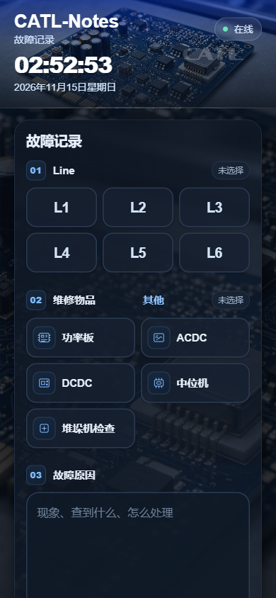

# CATL-电子维修 故障信息收集系统

内网故障信息登记 + 每日归档的小型系统。手机、电脑浏览器都能填写；数据存在本机
SQLite 里，同时每天生成 Markdown / CSV / JSON 归档，日报脚本可以直接读取。

- 抬头：**CATL**，蓝色背景
- 表单背景：半透明 PCBA 电路图（自制矢量图，不依赖外网图片）
- 配色跟随系统：白天为浅色主题，手机/电脑开启深色模式时自动切换暗黑主题
- 收集项：
  - 先选干什么：`堆垛机维修` `功率板` `ACDC` `DCDC` `中位机`（可自定义）
  - 再弹位置（同数量弹窗交互）：
    - 堆垛机维修：`L1–L6` + `A面/B面` + `高温/常温`
    - 普通板件：仅 `A面` / `B面`
  - 数量弹窗：选完位置后继续选数量
  - 故障原因：手动输入文字（必填）
- 每条记录支持「修改 / 删除」，填错可随时更正
- 每日汇总：每天 18:15 自动把当天多条记录合并成一条有用信息，18:20 前可用；
  也可以随时手动生成、一键复制
- 每次启动随机分配端口，手机与电脑用同一个地址访问
- 零第三方依赖，仅需 Python 3.10+（本机用 Python 3.14 验证）

## 界面预览




（截图使用演示数据，仅用于说明界面。）

## 1. 启动与访问

### 前台启动（推荐日常用）

双击 **`启动.bat`**，窗口里会显示随机端口，例如：

```
访问地址: http://127.0.0.1:XXXX
访问地址: http://192.168.1.4:XXXX
```

浏览器打开第一个地址即可。手机与电脑在同一局域网时，打开第二个地址
（以窗口实际显示为准）。关闭窗口即停止服务。

### 后台启动（不占窗口）

双击 **`后台启动.bat`**：隐藏运行并自动打开浏览器。停止时双击
**`停止服务.bat`**。

### 端口说明

- 默认随机端口，重启后会变；当前端口记录在 `runtime/port.txt` 和
  `runtime/server.json`。
- 想固定端口：`python app.py --port 8765`。
- 电脑有多块网卡时，窗口会列出全部可用地址；手机连哪个 Wi-Fi，就用同网段的地址。
- 本机已有 Python 的“Python”入站防火墙规则（TCP/UDP，Public 配置文件，允许任意端口），
  一般手机可直接访问。若换电脑部署，第一次访问时需在 Windows 防火墙里允许 Python。

### 在 Linux 服务器上常驻运行（192.168.1.8）

共享所在服务器也可以直接常驻运行，访问地址为 **http://192.168.1.8:XXXXX/**。
Linux 端使用独立的运行目录，避免覆盖 Windows 端的 `runtime/server.json`：

```bash
cd /srv/sw-file/CATL/CATL-CFBC-InfoDB
CFBC_RUNTIME=/var/lib/catl-cfbc/runtime \
  nohup python3 app.py --port 46995 --force > /var/lib/catl-cfbc/stdout.log 2>&1 &
```

注意：数据库同一时间只应有一个实例写入。启用本机地址前，请在 Windows 上双击
`停止服务.bat` 停掉 192.168.1.4 的实例，避免两个进程同时写同一个 SQLite 文件。

## 2. 每天怎么更新

1. 提交、修改或删除记录时，立刻写入数据库，并同步重新生成当天的
   JSONL / Markdown / JSON / CSV。
2. 每天 18:15 自动把当天已有多条记录合并成一条汇总（18:20 前可用）；
   新增、修改、删除记录后会自动刷新。也可在右侧「每日汇总」点“立即汇总”随时生成。
3. 每天 `00:00` 后自动切换新日期，并生成前一天和新一天的归档。
4. 网页右侧“每日归档 / 日报取数”可以查看历史日期、下载 CSV / Markdown、复制摘要。
5. 每天的数据文件（文件名中的日期即工作日）：

```
data/cfbc_records.db         SQLite 主数据库（唯一写入口是 app.py）
logs/YYYY-MM-DD.jsonl        当天原始记录，一行一条
daily/YYYY-MM-DD.md          当天 Markdown 汇总（可直接贴日报）
daily/YYYY-MM-DD.json        当天 JSON（统计 + 明细）
daily/YYYY-MM-DD.csv         当天 CSV（UTF-8 BOM，Excel 可直接打开）
```

> 数据库放在网络共享盘上，SQLite 使用 DELETE 日志模式，避免 WAL 在 SMB 上的兼容问题。
> 只运行一个 `app.py` 写库即可；不要在别的电脑同时用写模式打开数据库文件。

## 3. 给“每日日志”读取

### 命令行读取（推荐）

```powershell
# 默认输出今天的 Markdown
python "\scripts\daily_digest.py"

# 指定日期
python "\scripts\daily_digest.py" --date 2026-11-13

# 输出 JSON / CSV
python "\scripts\daily_digest.py" --date 2026-11-13 --format json
python "\scripts\daily_digest.py" --date 2026-11-13 --format csv

# 写到指定文件；--write 只重新生成归档文件
python "\scripts\daily_digest.py" --date 2026-11-13 --out "D:\当日CFBC.md"
python "\scripts\daily_digest.py" --date 2026-11-13 --write

# 查看有记录的日期
python "\scripts\daily_digest.py" --list
```

Markdown 内容是“当日汇总 + 故障明细”表格，可直接粘到 `每日工作日报` 的
“今日工作内容”里，再按自己的日报口径删改。

### 直接查 SQLite

```sql
-- 某天的全部记录
SELECT line AS 拉线, item AS 维修物品, fault_reason AS 故障原因, created_at AS 记录时间
FROM v_daily
WHERE work_date = '2026-11-13'
ORDER BY created_at;

-- 每天条数
SELECT work_date, COUNT(*) AS n
FROM records
GROUP BY work_date
ORDER BY work_date DESC;

-- 当天汇总（18:20 前自动生成，auto=1 表示自动）
SELECT summary, total, auto, updated_at
FROM daily_summaries
WHERE work_date = '2026-11-13';
```

### HTTP 接口

| 方法 | 地址 | 说明 |
| --- | --- | --- |
| GET | `/api/bootstrap` | 页面初始化（今天、配置、统计、明细） |
| GET | `/api/records?date=YYYY-MM-DD` | 某天记录 + 统计 + 当日汇总 |
| POST | `/api/records` | 新增记录，JSON：`{"line":"L4","item":"功率板","fault_reason":"..."}` |
| POST | `/api/records/<id>/update` | 修改记录，JSON 同上 |
| POST | `/api/records/<id>/delete` | 删除记录 |
| POST | `/api/summary` | 生成/刷新当天汇总，JSON：`{"date":"YYYY-MM-DD"}` |
| GET | `/api/health` | 健康检查、当前端口、总条数 |
| GET | `/api/dates` | 有记录的日期列表 |
| GET | `/api/daily/YYYY-MM-DD.md` | 当天 Markdown |
| GET | `/api/daily/YYYY-MM-DD.json` | 当天 JSON |
| GET | `/api/daily/YYYY-MM-DD.csv` | 当天 CSV（浏览器下载） |

也可以用表单方式 POST：

```powershell
Invoke-RestMethod "http://127.0.0.1:端口/api/records" -Method Post `
  -ContentType "application/x-www-form-urlencoded" `
  -Body "line=L2&item=ACDC&fault_reason=测试"
```

## 4. 数据维护

- 备份：直接复制 `data/`、`daily/`、`logs/` 三个文件夹。
- 恢复：把这三个文件夹放回原位，重启服务。
- 误填的处理：目前页面不开放删除，避免内网误删；可在 SQLite 里按 `id` 删除后，
  运行一次 `daily_digest.py --date 日期 --write` 重生成当天归档。
- 修改“拉线 / 维修物品”备选项：同时改 `app.py` 顶部的 `LINES`、`ITEMS`，以及
  `static/index.html` 里对应的选择项；两处要一致。
- 自动开机启动（可选）：把 `后台启动.bat` 的快捷方式放进
  `Win+R` → `shell:startup` 打开的启动文件夹。本系统没有自动改注册表或计划任务。

## 5. 目录结构

```
CATL-CFBC-InfoDB/
├─ app.py                    HTTP 服务 + SQLite + 每日归档
├─ 启动.bat                  前台启动，控制台显示访问地址
├─ 后台启动.bat              隐藏启动并打开浏览器
├─ 停止服务.bat              停止后台服务
├─ static/
│  ├─ index.html
│  ├─ style.css              响应式样式（手机 / 平板 / 电脑）
│  ├─ app.js                 页面交互
│  ├─ pcba-circuit.svg       半透明 PCBA 电路图背景
│  └─ favicon.svg
├─ scripts/
│  ├─ daily_digest.py        日报取数脚本
│  ├─ start_background.ps1
│  └─ stop_background.ps1
├─ data/                     SQLite 数据库
├─ logs/                     每日 JSONL 原始记录
├─ daily/                    每日 Markdown / JSON / CSV
└─ runtime/                  端口、进程信息、后台日志
```

## 6. 注意

- 页面没有登录/权限控制，只适合放在内网或本机，不要映射到公网。
- 记录会保存提交时的本机 IP 和浏览器 User-Agent 用于排查，不在页面上展示。
- 随机端口会变；如果手机收藏了旧地址，重启电脑后需要重新看 `runtime/port.txt`。
- 服务必须保持运行，数据才会持续写入；电脑关机后手机访问会失败。
